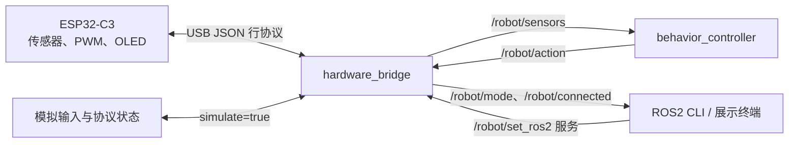

# 小纸壳机器人：ROS2 感知与控制学习项目

用一台可以摸头、转头和显示表情的纸壳机器人，实践 **ROS2 Jazzy 的节点通信、话题订阅发布、服务调用、参数配置、Launch 启动和硬件桥接**。项目将传感器接入、行为决策和底层执行分开，便于观察“输入如何变成动作”的完整过程。

电脑端使用 Python / `rclpy`，ESP32-C3 使用 MicroPython。通过同一套 ROS2 节点，可以先进行无硬件的协议模拟，再连接真实机器人。机器人也保留不依赖电脑的独立互动模式。

## 这个项目展示哪些 ROS2 知识

| 知识点 | 项目里的实现 | 可以展示的证据 |
| --- | --- | --- |
| 节点与职责划分 | `hardware_bridge` 接入设备，`behavior_controller` 负责决策 | `ros2 node list`、`ros2 node info` |
| Publisher / Subscriber | 发布传感器快照、订阅动作；订阅快照、发布决策 | `/robot/sensors`、`/robot/action`、`rqt_graph` |
| Service | 用 `std_srvs/SetBool` 请求接管或退出 ROS2 控制 | `/robot/set_ros2` 的请求与响应 |
| Parameters | 模拟左右红外与触摸，运行时修改返回等待时间 | `ros2 param list/get/set` |
| Timer | 桥接约 10Hz，决策约 20Hz | `create_timer`、`ros2 topic hz` |
| Launch | 模拟和实物入口复用同一套节点配置，明确参数类型 | `sim.launch.py`、`hardware.launch.py` |
| DDS 节点发现 | 各终端统一本机发现范围与通信域 | `tools/ros2_env.bash` |
| 状态与异常处理 | 接管先回默认姿势；消息过期后回到独立模式 | `/robot/mode`、集成测试日志 |
| ROS2 工程组织 | `ament_python` 包、colcon 构建、入口安装与检查 | `package.xml`、`setup.py`、`tools/check_launch.py` |

## 系统结构



- **桥接节点**把设备数据转换成 ROS2 消息，并把 ROS2 动作转换为 USB 命令；真实串口和模拟器由启动参数选择。
- **决策节点**处理“触摸优先、左侧检测转左、右侧检测转右、物体离开延时返回”的规则，不直接操作串口和 GPIO。
- **ESP32**负责输入消抖、平滑 PWM、舵机限幅和 OLED。它通过 USB 协议接入，板上运行的是 MicroPython 程序，不是 ROS2 节点。
- **模拟模式**生成布尔输入并验证消息/控制流程，不包含 3D 模型或舵机动力学。

## 两种控制模式

| 模式 | 决策在哪里运行 | 用途 |
| --- | --- | --- |
| `standalone` | ESP32 | 上电默认独立互动；ROS2 可读取传感器 |
| `ros2` | 电脑上的 `behavior_controller` | 展示 ROS2 感知、决策、执行链路 |

启动 ROS2 节点不会自动接管。调用服务后，实物先经过 `centering` 回默认姿势，再进入目标模式。服务返回 `success=True` 表示请求被接受，**以 `/robot/mode` 确认实际模式**。协议模拟不计算机械运动时间，因此可能直接看到目标模式。

桥接检测到传感器或动作消息超过约 0.5 秒未更新，会取消接管；ESP32 约 1 秒收不到有效命令时也会回退。重新连接后需要再次请求接管。

## 快速开始：先用模拟模式学习

环境：Ubuntu 24.04、ROS2 Jazzy、Python 3。依赖包括 `rclpy`、`std_msgs`、`std_srvs`、`launch_ros`、`python3-serial` 和 colcon。

在**本项目根目录**打开终端，首次使用或修改 Launch 后构建：

```bash
source /opt/ros/jazzy/setup.bash
cd ros2_ws
colcon build --symlink-install --packages-select cardboard_robot
cd ..
source tools/ros2_env.bash
```

`tools/ros2_env.bash` 加载工作空间，使用 Jazzy 的本机发现设置和通信域 74，不修改 `.bashrc`。**每个新终端都先进入本项目根目录，再 source 该文件**。同一通信域只运行一组本项目节点；切换启动方式前停止上一组。

### 1. 终端 A：启动两个模拟节点

```bash
source tools/ros2_env.bash
ros2 launch cardboard_robot sim.launch.py
```

保持终端运行。模拟模式不需要连接 ESP32。

### 2. 终端 B：观察节点、消息与初始状态

```bash
source tools/ros2_env.bash
ros2 node list
ros2 topic list -t
ros2 topic echo /robot/mode std_msgs/msg/String --once
```

应看到 `/hardware_bridge`、`/behavior_controller`，模式初始为 `standalone`。

### 3. 请求 ROS2 接管

```bash
ros2 service call /robot/set_ros2 std_srvs/srv/SetBool '{data: true}'
ros2 topic echo /robot/mode std_msgs/msg/String --once
```

预期模式为 `ros2`。

### 4. 模拟感知，观察决策

```bash
# 模拟左边出现物体，动作应变成 look_left。
ros2 param set /hardware_bridge sim_left true
ros2 topic echo /robot/action std_msgs/msg/String --once

# 保留左侧物体，再模拟摸头，观察触摸优先：动作变成 bow。
ros2 param set /hardware_bridge sim_touch true
ros2 topic echo /robot/action std_msgs/msg/String --once

# 撤销模拟输入。
ros2 param set /hardware_bridge sim_touch false
ros2 param set /hardware_bridge sim_left false
```

`ros2 topic echo /robot/action` 可持续观察动作，结束查看按 Ctrl+C。参数设置请求成功后，决策要经过下一次定时器更新；单次读取若恰好看到旧值，再读一次。

### 5. 演示参数与模式切换

```bash
ros2 param get /behavior_controller return_delay_ms
ros2 param set /behavior_controller return_delay_ms 1000
ros2 service call /robot/set_ros2 std_srvs/srv/SetBool '{data: false}'
ros2 topic echo /robot/mode std_msgs/msg/String --once
```

返回等待时间改为 1 秒，无需重启节点；退出后模式为 `standalone`。

完整的展示顺序和讲解词见 [ROS2 演示与讲解](docs/ros2_demo.md)。

## Launch 文件与参数

| 文件 | 作用 | 示例 |
| --- | --- | --- |
| `sim.launch.py` | 固定使用模拟输入 | `ros2 launch cardboard_robot sim.launch.py` |
| `hardware.launch.py` | 固定使用真实串口 | `ros2 launch cardboard_robot hardware.launch.py port:=/dev/ttyACM0` |
| `robot.launch.py` | 两个入口复用的统一启动文件，也保留原命令兼容 | `ros2 launch cardboard_robot robot.launch.py simulate:=true` |

```bash
# 查看可配置参数。
ros2 launch cardboard_robot sim.launch.py --show-args

# 演示启动时传参：一开始就检测到左侧物体，返回等待时间 800ms。
ros2 launch cardboard_robot sim.launch.py sim_left:=true return_delay_ms:=800
```

| 参数 | 默认值 | 用途 |
| --- | --- | --- |
| `simulate` | `false` | 统一入口选择模拟或实物；两个专用入口分别固定此值 |
| `port`、`baud` | `/dev/ttyACM0`、`115200` | 实物串口与波特率 |
| `sim_left/right/touch` | 均为 `false` | 模拟输入，支持运行时 `ros2 param set` |
| `return_delay_ms` | `400` | 决策节点在物体消失后保持方向的时间，支持运行时修改 |
| `sensor_timeout_ms` | `500` | 决策节点允许的传感器消息最大间隔，支持运行时修改 |
| `log_level` | `info` | 启动时选择两个节点的日志级别 |

Launch 参数是启动配置；节点参数是运行配置。启动文件使用 `ParameterValue` 将文本转换为 `bool/int`，通过 `Node(parameters=...)` 传入节点。运行中改变串口或模拟/实物选择，需要重新启动；`log_level` 使用 ROS 日志参数，不是本项目的动态节点参数。

## 接入真实机器人

ESP32 已保存正式程序、独立互动正常后，关闭 Thonny，停止旧模拟，使用 USB 数据线连接电脑。ROS2 控制时，ESP32 的 USB 供电/数据端接电脑，不同时接外部 USB 电源；舵机和传感器继续用原模块电源，共地。

```bash
source tools/ros2_env.bash
ls /dev/serial/by-id/
ros2 launch cardboard_robot hardware.launch.py port:=/dev/ttyACM0
```

串口按实际设备选择，优先使用 `/dev/serial/by-id/...` 的稳定路径。在另一终端等待 `/robot/sensors` 有消息，再通过服务请求接管。不要让 Thonny、串口监视器和桥接同时占用串口。

真实硬件、下载和供电步骤保留在 [硬件使用指南](docs/hardware.md)；接线见 [接线与装机](docs/wiring.md)。本次 README / Launch 调整不需要重新刷 ESP32 的 9 个 Python 文件。

## 主要 ROS2 接口

| 接口 | 类型 | 发布者 / 提供者 | 作用 |
| --- | --- | --- | --- |
| `/robot/sensors` | `std_msgs/msg/String` | 桥接 | 同次采样的 JSON 快照 |
| `/robot/touch`、`/robot/ir/left`、`/robot/ir/right` | `std_msgs/msg/Bool` | 桥接 | 便于单独观察输入 |
| `/robot/action` | `std_msgs/msg/String` | 决策 | `idle/look_left/look_right/look_center/bow` |
| `/robot/mode` | `std_msgs/msg/String` | 桥接 | `standalone/centering/ros2/disconnected` |
| `/robot/connected` | `std_msgs/msg/Bool` | 桥接 | 近期是否收到设备或模拟数据 |
| `/robot/set_ros2` | `std_srvs/srv/SetBool` | 桥接 | 请求接管或退出 |

话题使用深度为 1 的队列，偏向处理最新状态。输入是有无检测的布尔值；SG90 的指令脉宽不等于真实测量角度。数据格式和行为时序见 [ROS2 使用与源码说明](docs/ros2.md)。

## 项目组织与验证

```text
ros2_ws/src/cardboard_robot/
  cardboard_robot/bridge.py       串口、话题、服务、通信状态
  cardboard_robot/behavior.py     订阅快照、定时决策、动态参数
  cardboard_robot/core.py         协议解析、规则、模拟器
  launch/robot.launch.py         统一启动、参数类型、节点配置
  launch/sim.launch.py           模拟学习入口
  launch/hardware.launch.py      实物入口
  package.xml / setup.py         ROS2 依赖、入口和 Launch 安装
firmware/                       ESP32 MicroPython 正式程序
examples/                       各模块历史学习代码
tools/                          环境加载、语法及 ROS2 集成检查
tests/                          不依赖 ROS2 的逻辑测试
docs/                           演示、运行、硬件与实物记录
```

```bash
# 纯 Python 检查；GitHub Actions 运行这两项。
python3 tools/check_syntax.py
python3 -m unittest discover -s tests -v

# source 学习环境后，在独立通信域验证真实 ROS2 进程。
ROS_DOMAIN_ID=84 python3 tools/check_launch.py
ROS_DOMAIN_ID=85 python3 tools/check_ros2.py
ROS_DOMAIN_ID=86 python3 tools/check_ros2.py --serial
```

Launch 检查覆盖安装入口、参数类型与传递、话题、服务和动态参数；另外两项分别检查模拟链路、伪终端串口与固件状态机，包括停止决策后退出接管。伪终端不是实际 ESP32。

已完成的硬件测试及边界见 [实物记录](docs/实物运行_2026-10-18.md)。电脑测试和模拟通过不能替代实物机械、串口与供电验证。第三方驱动说明见 [THIRD_PARTY_NOTICES.md](THIRD_PARTY_NOTICES.md)。
